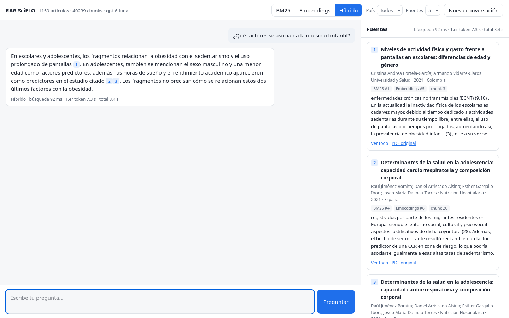
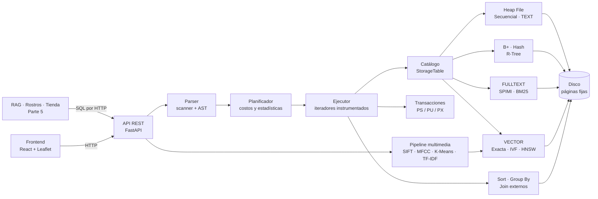

<div align="center">

# MiniGestor BD2

### Gestor de bases de datos multimodal construido desde cero

Archivos paginados · índices B+, hash y R-Tree · SQL con planificador por costos · `EXPLAIN ANALYZE` · transacciones · consultas espaciales sobre un mapa · búsqueda de texto con BM25 · similitud de imágenes y audio con IVF y HNSW · tres aplicaciones sobre el motor


</div>

---

## Qué hace

<table>
<tr>
<td width="50%" valign="top">

**Parte 1 · Relacional**

- Heap File con reutilización de espacio y archivo secuencial con reorganización
- Índices **B+ agrupado**, **B+ no agrupado** y **hash extensible**
- Índices secundarios con `CREATE INDEX`
- `ORDER BY`, `GROUP BY` y `JOIN` externos (k-way merge y grace hash join)
- `WHERE` con `AND`, `OR`, `NOT`, `BETWEEN`, `IN`, `LIKE`, `IS NULL`
- Varios `JOIN` encadenados con filtros bajados a cada tabla
- Valores `NULL` con semántica SQL
- Planificador por costos y `EXPLAIN` / `EXPLAIN ANALYZE` como PostgreSQL
- Transacciones con bloqueos PS / PU / PX

</td>
<td width="50%" valign="top">

**Parte 2 · Espacial**

- Tipo `POINT` y un **R-Tree en disco** por cada columna espacial
- Consultas por **radio**, **k vecinos más cercanos** y **polígono**
- Distancias **Haversine** (metros) y **Euclidiana**
- `distancia(...)` e `intersecta(...)` dentro del SQL
- El planificador elige el R-Tree por costo, también dentro de un `JOIN`
- Mapa interactivo con los resultados resaltados
- Visualización de los MBR del R-Tree por nivel

</td>
</tr>
<tr>
<td width="50%" valign="top">

**Parte 3 · Texto**

- Tipo `TEXT` en un archivo aparte con compactación al 30 % de basura
- Preprocesamiento: tokens, 608 stopwords y stemming Snowball en español
- Índice **`FULLTEXT` invertido** construido con **SPIMI** y merge k-way
- Ranking **TF-IDF + coseno** o **BM25** con `k1` y `b` configurables
- `MATCH(...)`, `SCORE()` y `LIMIT` combinados con otros filtros
- `Text Index Scan` en `EXPLAIN` con los términos y el ranking
- Benchmark contra PostgreSQL GIN con 1 000 a 100 000 documentos

</td>
<td width="50%" valign="top">

**Parte 4 · Multimedia**

- Tipo `VECTOR(n)` guardado en un archivo mapeado en memoria
- Descriptores **SIFT** (imágenes) y **MFCC** (audio)
- Bolsa de palabras visuales: **K-Means** con 256 palabras + TF-IDF
- Búsqueda **exacta**, **IVF** y **HNSW** (sobre FAISS)
- Métricas euclidiana, coseno y producto interno
- `SIMILAR_TO('archivo' | VECTOR(...), k=...)` y `SIMILARITY_SCORE()`
- Filtros con relleno ×4 hasta tener k filas
- Tramos parecidos entre audios y galería con imágenes y audio en la interfaz

</td>
</tr>
</table>

**Parte 5 · Aplicaciones**

Tres servicios aparte que solo hablan con el motor por `POST /api/query`:

| Aplicación | Qué hace | Usa del motor |
|---|---|---|
| 💬 [RAG SciELO](rag/README.md) | Chat que responde sobre 1 159 artículos científicos en español y cita sus fuentes | BM25 + HNSW fusionados con RRF, filtros por país y año |
| 🙂 [Reconocimiento facial](rostros/README.md) | App móvil que reconoce caras en tiempo real con YuNet y ArcFace | HNSW coseno sobre 13 233 rostros de LFW, transacciones, caché Redis |
| 🛒 [Tienda con recomendaciones](ecommerce/README.md) | Catálogo que recomienda productos y sucursales cercanas | `JOIN` + `GROUP BY` (co-compra), BM25, HNSW visual y R-Tree |

<div align="center">

<br><sub>RAG SciELO: respuesta con citas [n] y, a la derecha, los fragmentos recuperados con su posición en BM25 y en embeddings</sub>
</div>

## Inicio rápido

Con [Docker](https://docs.docker.com/get-docker/) basta un comando:

```bash
docker compose up --build
```

Abre <http://localhost:8080>. Los CSV de demo se generan solos en `data/demo/`; impórtalos desde el panel **Archivos**.

Las aplicaciones de la Parte 5 son profiles del mismo `docker-compose.yml` (`rag`, `ecommerce` y `rostros`). Para levantar todo junto:

```bash
docker compose --profile "*" up -d --build
```

| Servicio | URL |
|---|---|
| Motor y frontend | <http://localhost:8080> |
| RAG SciELO | <http://localhost:8100> |
| Reconocimiento facial | <http://localhost:8200> |
| Tienda | <http://localhost:8300> |

Cada aplicación necesita cargar sus datos una vez; los pasos están en su README ([`rag`](rag/README.md), [`ecommerce`](ecommerce/README.md), [`rostros`](rostros/README.md)).

Para desarrollo sin Docker:

> [!NOTE]
> Requisitos: Python 3.11+, Node 18+ y [pnpm](https://pnpm.io) 9.

```bash
pnpm install
pnpm run setup
pnpm dev
```

Abre <http://localhost:5173>. El backend queda en el puerto 8000.

`pnpm dev` también levanta las aplicaciones de la Parte 5 con `mprocs`: el RAG (8100), el reconocimiento facial con Redis y su app de Expo (8200) y la tienda (8300) con su propio motor en el puerto 8001. Cada una se instala una vez con `pnpm setup:rag`, `pnpm setup:rostros` y `pnpm setup:ecommerce`, y carga sus datos con su `ingesta.py`.

Para tener datos con los que probar, genera los CSV de demo (10 000 filas por tabla) e impórtalos desde el panel **Archivos**:

```bash
python3 data/generar_demo.py
```

La guía completa, con la configuración recomendada para cada tabla, está en [Instalación y primeros pasos](docs/01-instalacion.md).

## Una muestra del SQL

```sql
CREATE INDEX idx_pedidos_estado ON pedidos (estado) USING BPLUS;

EXPLAIN ANALYZE
SELECT t.distrito, COUNT(*), SUM(p.total)
FROM clientes c
JOIN pedidos p ON c.id = p.cliente_id
JOIN tiendas t ON p.tienda_id = t.id
WHERE p.estado = 'entregado'
  AND c.edad BETWEEN 25 AND 60
  AND distancia(t.ubicacion, mi_ubicacion) < 8000
GROUP BY t.distrito
ORDER BY t.distrito;
```

Cada tabla entra al `JOIN` por su mejor camino: `clientes` con un scan filtrado, `pedidos` con el índice secundario y `tiendas` con el R-Tree.

Búsqueda de texto con BM25:

```sql
CREATE TABLE documentos (id INT PRIMARY KEY, titulo VARCHAR(40), contenido TEXT);
CREATE INDEX idx_contenido ON documentos (contenido) USING FULLTEXT;

SELECT id, titulo, SCORE() AS s
FROM documentos
WHERE MATCH(contenido, 'inflación peruana') USING BM25 WITH K1=1.2, B=0.75
ORDER BY s DESC
LIMIT 5;
```

Imágenes parecidas con HNSW:

```sql
CREATE TABLE imagenes (id INT PRIMARY KEY, ruta VARCHAR(200), v VECTOR(256));
CREATE INDEX idx_img ON imagenes (v) USING HNSW WITH (METRIC=cosine, M=16, EF_CONSTRUCTION=64);

SELECT id, ruta, SIMILARITY_SCORE() AS s
FROM imagenes
WHERE SIMILAR_TO('consulta.jpg', k=5) USING HNSW WITH METRIC=cosine, EF_SEARCH=40
ORDER BY s DESC;
```

Los vectores de `imagenes` se calculan desde la columna de rutas con `POST /api/tables/imagenes/features`. La referencia completa está en [SQL](docs/02-sql.md).

## Arquitectura



## Documentación

| | Página | De qué trata |
|---|---|---|
| 🚀 | [Instalación y primeros pasos](docs/01-instalacion.md) | Requisitos, comandos, datos de demo y problemas comunes |
| 📝 | [SQL](docs/02-sql.md) | Referencia de todas las sentencias con ejemplos |
| 🧱 | [Arquitectura](docs/03-arquitectura.md) | Capas, recorrido de una consulta y estructura del repositorio |
| 💾 | [Almacenamiento](docs/04-almacenamiento.md) | Heap File, archivo secuencial y formato de registro |
| 🌳 | [Índices](docs/05-indices.md) | B+, hash extensible, índices secundarios y R-Tree |
| 🧠 | [Planificador y EXPLAIN](docs/06-planificador.md) | Modelo de costos, elección de índices, JOINs y algoritmos externos |
| 🔒 | [Transacciones](docs/07-transacciones.md) | Bloqueos, 2PL estricto y la simulación con hilos |
| 🗺️ | [Consultas espaciales](docs/08-espacial.md) | `POINT`, R-Tree, radio, k-NN, polígonos y métricas |
| 🖥️ | [Interfaz](docs/09-interfaz.md) | Recorrido por los paneles de la aplicación |
| ✅ | [Pruebas](docs/10-pruebas.md) | Cómo ejecutar las pruebas y qué cubren |
| ⚠️ | [Alcance y limitaciones](docs/11-limitaciones.md) | Lo que el sistema no hace |
| 🔎 | [Búsqueda de texto](docs/12-texto.md) | `TEXT`, índice `FULLTEXT` con SPIMI, `MATCH`, TF-IDF y BM25 |
| 🖼️ | [Pipeline multimedia](docs/13-multimedia.md) | SIFT, MFCC, vocabularios, `VECTOR`, `SIMILAR_TO`, IVF y HNSW |
| 💬 | [RAG SciELO](rag/README.md) | Chunking, embeddings e5, búsqueda híbrida con RRF y evaluación |
| 🙂 | [Reconocimiento facial](rostros/README.md) | YuNet, ArcFace, umbrales, caché Redis y la app de Expo |
| 🛒 | [Tienda con recomendaciones](ecommerce/README.md) | Señales, fusión de puntajes y consultas espaciales |
| 📊 | [Benchmarks](benchmarks/README.md) | Comparación experimental de técnicas y resultados |

## Estructura del repositorio

```
Proyecto_BD2/
├── backend/
│   ├── api/                 API REST (FastAPI)
│   └── engine/
│       ├── storage/         Heap File y archivo secuencial
│       ├── bplus/           B+ no agrupado y agrupado
│       ├── hashing/         hash extensible y algoritmos externos por hash
│       ├── external/        ordenamiento externo
│       ├── parser/          scanner, parser, AST y ejecutor
│       ├── plan/            planificador, costos, nodos y EXPLAIN
│       ├── transactions/    transacciones y bloqueos
│       ├── fulltext/        preprocesamiento, SPIMI, índice invertido y ranking
│       ├── multimedia/      SIFT, MFCC, histogramas y TF-IDF
│       ├── vectorial/       almacén de vectores, búsqueda exacta, IVF y HNSW
│       ├── rtree.py         R-Tree en disco
│       └── catalog.py       tablas, índices y estadísticas
├── frontend/                interfaz (React + Vite + Leaflet)
├── rag/                     chatbot RAG sobre SciELO
├── rostros/                 servicio de reconocimiento facial y app de Expo
├── ecommerce/               tienda con recomendaciones
├── scripts/                 descarga de datasets y entrenamiento de K-Means
├── benchmarks/              notebooks, scripts y resultados de cada parte
├── data/                    generadores de datos y vocabularios entrenados
└── docs/                    esta documentación
```

## Integrantes

| Integrante | Código | GitHub |
|---|---|---|
| Olivares Sarmiento, Javier Ignacio Leon | 202310689 | [@Javier1308](https://github.com/Javier1308) |
| Martínez Olivos, Félix Alberto | 202310685 | [@flxamartinez](https://github.com/flxamartinez) |
| Vargas Urmeneta, Gabriel | 202310129 | [@gab-o-11](https://github.com/gab-o-11) · [@MrGabo386](https://github.com/MrGabo386) |
| Hinojosa Bittrich, Michael Paul | 202310528 | [@m41k1204](https://github.com/m41k1204) |
| Soto Cristobal, Camilo Ernesto | 202210484 | [@Snah-s](https://github.com/Snah-s) |

---

<div align="center">
Proyecto del curso <b>Base de Datos II</b> · Universidad de Ingeniería y Tecnología (UTEC) · 2026-2
</div>
